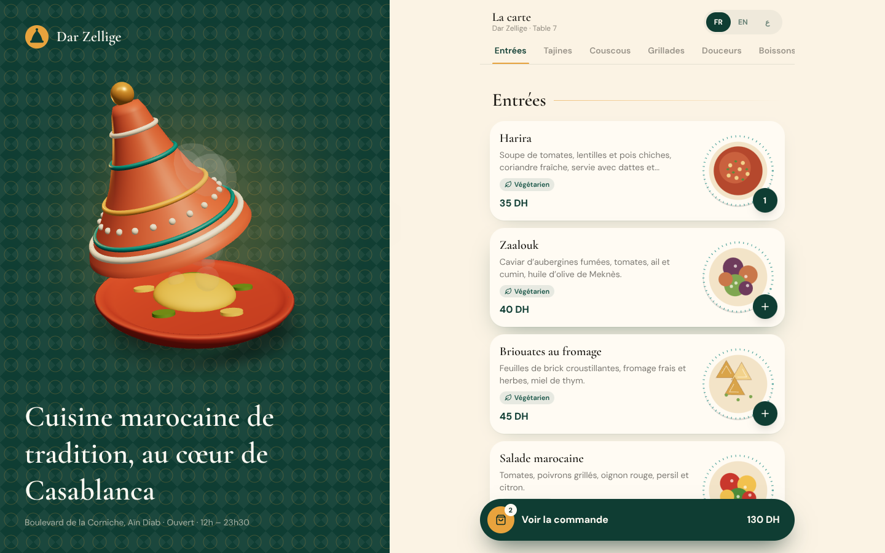
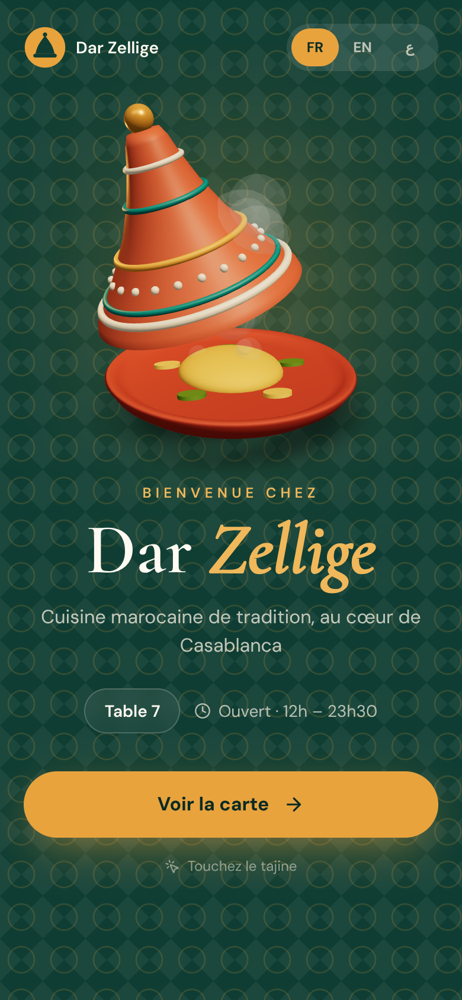

# Dar Zellige — QR Menu

> A mobile-first QR menu for a Moroccan restaurant in Casablanca: a 3D tajine welcome screen, swipeable bottom sheets, a live order and full French / English / Arabic support with right-to-left layout.



<p align="center"></p>

## Features

- **3D tajine** built entirely from `LatheGeometry` profiles in React Three Fiber: a glazed base, a conical lid with painted bands and dot work, a brass knob, food inside and rising steam particles. The lid lifts on its own after a moment and toggles when tapped; the whole piece can be dragged to rotate. Lazy-loaded with `React.lazy` + `Suspense`, DPR capped at 2, SVG fallback when WebGL is missing.
- **Welcome screen** with a zellige-patterned background, staggered editorial headline, and a circular `clip-path` wipe into the menu.
- **Category tabs with scroll-spy**: an `IntersectionObserver` highlights the section you are reading, and the saffron underline glides between tabs with a shared `layoutId`. Tapping a tab smooth-scrolls to its section.
- **Dish cards** with hand-drawn top-down SVG plates (harira, tajines, couscous, skewers, mint tea…), dietary tags, scroll reveals and a quick-add button whose count pops.
- **Dish detail bottom sheet** with **drag-to-dismiss** (`drag="y"` + `useDragControls`, closes on distance or flick velocity), a plate that morphs from the card via `layoutId`, a rolling quantity stepper and a live price.
- **Order bar and order sheet**: floating summary that springs in once something is added, editable quantities, a note for the kitchen, a total in MAD and an animated "order sent" confirmation.
- **FR / EN / AR language switch**: every dish, description and label is translated; Arabic switches the document to `dir="rtl"`, swaps to the Cairo typeface and mirrors the layout with Tailwind logical properties (`ps-`, `pe-`, `start-`, `end-`).
- **Desktop layout**: a fixed brand panel with the 3D tajine sits beside the phone-width menu, so the same app works on a tablet at the host stand.
- Honours `prefers-reduced-motion` through `MotionConfig reducedMotion="user"`.

## Tech stack


## Getting started

```bash
npm install
npm run dev      # http://localhost:5173 (open it on your phone via the network URL)
npm run build    # production build in dist/
npm run preview  # serve the production build
```

## Project structure

```
src/
├── components/
│   ├── Welcome.jsx       # splash with 3D tajine, language switch, CTA
│   ├── Menu.jsx          # header, scroll-spy tabs, sections, order bar
│   ├── DishCard.jsx      # card + dietary tags
│   ├── DishArt.jsx       # SVG plate illustrations
│   ├── BottomSheet.jsx   # reusable drag-to-dismiss sheet
│   ├── DishSheet.jsx     # dish detail + quantity
│   ├── OrderSheet.jsx    # order review + confirmation
│   ├── LangSwitch.jsx    # FR / EN / AR segmented control
│   └── Brand.jsx         # logo, lazy 3D stage + fallback
├── three/
│   ├── Tajine.jsx        # lathe-built tajine, lid animation, steam
│   └── webgl.js
├── context/AppContext.jsx  # language, RTL, order state
├── data/
│   ├── menu.js           # 20 dishes in 3 languages, prices in MAD
│   └── i18n.js           # UI strings
├── App.jsx
└── main.jsx
```

## Design notes

**Palette** — taken from a Casablanca riad: deep emerald (`#0F3D33`) like glazed zellige tiles, warm cream (`#FBF3E4`) for the paper of the menu, saffron (`#E8A33D`) for actions and highlights, terracotta (`#B5482D`) for the tajine and spicy dishes, and a turquoise (`#1F8A84`) accent echoing Fès pottery.

**Typography** — [Cormorant Garamond](https://fonts.google.com/specimen/Cormorant+Garamond) for dish names and headings (elegant, high-contrast, restaurant-menu feel), [DM Sans](https://fonts.google.com/specimen/DM+Sans) for descriptions and UI, and [Cairo](https://fonts.google.com/specimen/Cairo) for Arabic, chosen for its legibility on small screens.

**Motion** — designed for one hand and a phone:
- Bottom sheets use a stiff spring (`380 / 38`) with elastic drag only downward, so they feel physical but never wobbly.
- The plate *travels* from the card into the sheet (`layoutId`) and slowly turns, like a waiter presenting the dish.
- Counters roll vertically when quantities change; the order bar springs in from below once there is something to order.
- The welcome-to-menu transition is a single circular wipe, the only "theatrical" moment besides the steaming tajine.

## Author

**Zakaria Dabella** — UI/UX designer & web developer based in Casablanca, Morocco.

- Portfolio: [zakaria-dabella-portfolio.vercel.app](https://zakaria-dabella-portfolio.vercel.app/)
- GitHub: [@zakaria10-dabella](https://github.com/zakaria10-dabella)

## License

[MIT](LICENSE) © 2026 Zakaria Dabella
